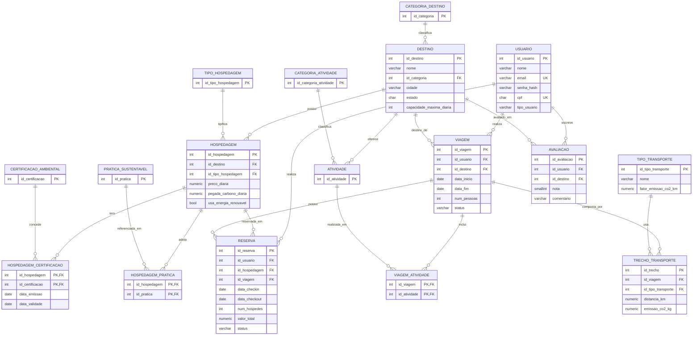

# Modelo de Dados — EcoViagem

## Diagrama Entidade-Relacionamento (DER)

> Renderiza no GitHub/VS Code (Mermaid). Para o relatório em PDF, use um print
> deste diagrama ou importe-o em uma ferramenta como o [dbdiagram.io](https://dbdiagram.io).

## Entidades (resumo)

| Entidade | Papel |
|----------|-------|
| `categoria_destino`, `tipo_hospedagem`, `certificacao_ambiental`, `tipo_transporte`, `categoria_atividade`, `pratica_sustentavel` | Tabelas de domínio (lado "1") |
| `usuario` | Turistas, gestores e administradores |
| `destino` | Destinos turísticos (com capacidade diária) |
| `hospedagem` | Hospedagens de um destino (adotam práticas sustentáveis) |
| `atividade` | Atividades de um destino |
| `viagem` | Viagem de um usuário para um destino (usa transporte via trechos) |
| `reserva` | Reserva de hospedagem de um usuário (opcionalmente de uma viagem) |
| `trecho_transporte` | Deslocamentos de uma viagem (geram pegada de CO₂) |
| `avaliacao` | Nota/comentário de um usuário sobre um destino |
| `hospedagem_certificacao`, `hospedagem_pratica`, `viagem_atividade` | Associativas N:N |
| `log_auditoria` | Trilha de auditoria (preenchida por triggers) |

## Normalização (até a 3ª Forma Normal)

- **1FN** — todos os atributos são atômicos; não há grupos repetitivos. Listas
  (ex.: certificações e práticas de uma hospedagem, atividades de uma viagem) foram
  extraídas para **tabelas associativas** (`hospedagem_certificacao`,
  `hospedagem_pratica`, `viagem_atividade`).
- **2FN** — está em 1FN e não há dependências parciais. Nas tabelas com chave
  composta (associativas N:N), os atributos descritivos dependem da chave inteira
  (ex.: `data_emissao`/`data_validade` dependem do par hospedagem+certificação).
- **3FN** — não há dependências transitivas. Atributos como o **nome da categoria**,
  o **tipo de hospedagem** ou o **fator de emissão do transporte** ficam em suas
  próprias tabelas e são referenciados por FK, em vez de repetidos nas entidades
  principais. Assim, por exemplo, mudar o fator de emissão de um modal é feito em
  um único lugar (`tipo_transporte`).

Valores **derivados** (emissão de CO₂ do trecho, índice de sustentabilidade do
destino, pegada total da viagem) **não são armazenados de forma redundante**: são
calculados por **trigger** (no momento da escrita) ou por **view/função** (na
leitura), evitando anomalias de atualização.
